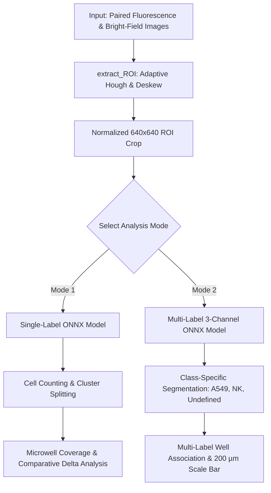

# Microwell Cell Counter & Cytotoxicity Assay Platform (CellApp)

[-41CD52.svg)](https://pypi.org/project/PySide6/)

*Dedicated computer vision and deep learning platform for automated microwell array alignment, cell segmentation, cell counting, and microwell coverage quantification in monoculture and immune-cancer co-culture assays.*

---

## 📑 Table of Contents

- [1. Overview](#1-overview)
- [2. Analysis Modes](#2-analysis-modes)
  - [Mode 1: Single-Label Quantification](#mode-1-single-label-quantification)
  - [Mode 2: Multi-Label Co-Culture Analysis](#mode-2-multi-label-co-culture-analysis)
- [3. Detection Optimization for NK & Undefined Labels](#3-detection-optimization-for-nk--undefined-labels)

---

## 1. Overview

In cell biology and cancer immunotherapy research, $10\times 10$ ($100$ wells) microwell arrays are widely utilized to isolate, observe, and quantify cellular interactions at single-cell or small-cluster resolution.

**CellApp** addresses core automated bioimaging challenges:
1. **Automated Microwell Grid Alignment (Deskew & Crop):** Processes bright-field images to locate well centers using an adaptive multi-pass Hough transform, accurately computes rotation skew, and crops the $10\times 10$ microwell array.
2. **Deep Learning Segmentation (ONNX Runtime):** Runs high-throughput neural network inference across CPU and GPU hardware backends with zero-latency threading.
3. **Cluster Splitting (CLAHE Intensity Peaks):** Detects local intensity maxima inside large connected components to reliably count individual cells within tight cellular clusters.
4. **Multi-Label Immunological Co-Culture Classification:** Simultaneously identifies and differentiates lung carcinoma cells (**A549**), natural killer immune cells (**NK**), and contact-zone / intermediate cells (**Undefined**).

---

## 2. Analysis Modes

### Mode 1: Single-Label Quantification
- **Application:** Monoculture assays, cell proliferation monitoring, and microwell occupancy quantification.
- **Key Features:**
  - Automated microwell array detection, deskewing, and standardized cropping.
  - **Comparative Delta Analysis:** Allows the user to select any two samples to compute differential cell counts ($B - A$), coverage percentage delta, and pinpoint the exact row/column coordinates of wells that gained or lost cells.

### Mode 2: Multi-Label Co-Culture Analysis
- **Application:** Immune-cancer cytotoxicity assays measuring Natural Killer (**NK**) interaction with lung carcinoma (**A549**) target cells.
- **Visual Classification Palette:**
  - **A549 (Cancer Cell):** Green border (`#00FF00`).
  - **NK (Immune Cell):** Red border (`#FF0000`).
  - **Undefined (Ambiguous / Contact Zone):** Cyan border (`#00FFFF`).
  - **Co-occupied Microwell (Both A549 & NK):** Dual concentric circles (outer green ring for A549, inner red ring for NK).
- **Interactive Controls:**
  - **Grid Mode:** `Full grid`, `Full red grid`, `Only a549`, `Only nk`, `Hide`.
  - **Multi-Mask Mix & Match Checkboxes:** Independent toggles for each cell class (`[x] A549`, `[x] NK`, `[x] Undefined`) allowing researchers to visualize any combination of segmentation masks simultaneously (e.g. A549 + NK, single class, or completely hidden) instead of a rigid single-select dropdown.
  - **Scale Bar:** Displays calibrated $200\,\mu\text{m}$ scale indicator.
  - **High-Resolution Export:** Exports publication-ready images ($300\text{ DPI}$) in PNG, TIFF, or JPEG.

---

## 3. Detection Optimization for NK & Undefined Labels

To achieve robust detection across diverse microscope imaging conditions, prevent border artifacts, and eliminate false positives:

1. **Autofluorescence Pedestal Baseline Subtraction:**
   - In fluorescence microscopy, unspecific autofluorescence creates an elevated pedestal baseline (~15–40 intensity). Without correction, neural segmentation models can saturate across the whole frame, causing all cells to merge into a single border-spanning mass that gets rejected by artifact filters (resulting in 0 cell counts).
   - An adaptive 5th percentile subtraction per channel gently pulls the pedestal floor down near zero, reliably unveiling faint and dim cells across all image batches without affecting high-confluence colonies.
2. **Competitive Dominance Suppression for Undefined False Positives:**
   - Evaluated independently, intermediate class channels can co-activate across strong cancer cells.
   - Enforces mutual exclusion: a pixel is assigned to `Undefined` only if `prob[undefine] > 0.40` AND `prob[undefine] >= prob[a549]` AND `prob[undefine] >= prob[nk]`. This completely stops cyan undefined halos from falsely overwriting genuine green A549 cancer cells.
3. **Cell-Scale Adaptive Filtering (`MODE2_CLASS_MIN_AREAS`):**
   - Natural killer cells are small lymphocytes ($7 - 10\,\mu\text{m}$ diameter, corresponding to $10 - 25\text{ px}^2$ at 640x640 resolution).
   - Class-specific area thresholds (`nk: 6 px`, `undefine: 20 px`, `a549: 15 px`) prevent small isolated cells from being discarded as noise while filtering non-cellular debris and speckle artifacts.
4. **Selective Border Noise Suppression Without Erasing Edge Cells:**
   - Instead of discarding border-touching components, the algorithm distinguishes between broad edge-padding noise strips ($> 70\text{ px}$ along image borders) and compact genuine cells touching the frame edge ($\le 50\text{ px}$). Real cells located near outer image margins are completely preserved.
5. **True Multi-Channel Peak Preservation:**
   - Replaced standard RGB-to-Grayscale conversion (which attenuates Red by $> 70\%$) with channel-maximum intensity extraction (`np.max(patch, axis=2)`). Both red NK and green A549 fluorescent peaks maintain full intensity for cluster splitting.
6. **Microwell Rim Association (`distance <= radius_px`):**
   - Cells adhering to the microwell rim/boundary are fully recognized and correctly assigned to their respective wells.
7. **Cross-Platform Light Theme Enforcement (`apply_light_theme`):**
   - Enforces a high-contrast Light Theme across Windows 10/11, macOS, and Linux, ensuring all text labels, combo boxes, and panels remain legible regardless of OS Dark Mode settings.
8. **Dynamic Responsive Launcher Spacing:**
   - Automatically computes mode selection list item height and spacing ($48\text{ px}$ items with $6\text{ px}$ margins), preventing overlapping text and seamlessly accommodating future analysis modes without layout clipping.
